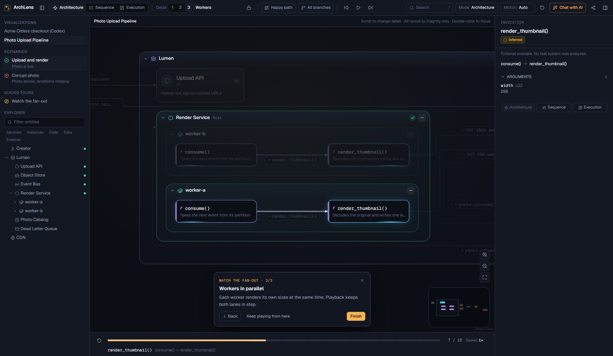

  

<h1 align="center">ArchLens</h1>

See how software really works, at every level of detail.

  <a href="#install"><strong>Download</strong></a> ·
  <a href="https://archlens.net">Try it in your browser</a> ·
  <a href="./docs/guide.md">Guide</a> ·
  <a href="./CHANGELOG.md">Changelog</a> ·
  <a href="https://github.com/mefaba/archlens-release/issues">Issues</a>

  

ArchLens turns software systems into interactive, animated visualizations. Zoom from the whole system down to one function call, then watch a request travel through it.

It works with Codex, Claude Code and Antigravity CLI. Ask your agent to visualize a repository, and it draws the diagram from the code.

## What you get

- **Zoom for detail.** Scroll in and a system opens into its services, a service into its instances, an instance into the functions it runs.
- **Watch it run.** Play a scenario step by step and follow every request, event and error in order.
- **Three perspectives.** The same story as an architecture diagram, a sequence diagram or a list of calls.
- **Know what is verified.** Everything says how it is known: read in the code, documented, observed, or only inferred. A source opens in your editor at the line it cites.
- **AI does the drawing.** Codex, Claude Code or Antigravity CLI reads your repositories, builds the visualization, then improves it as you chat.
- **Your code stays with you.** Agents run on your computer, with the sign-in you already have. ArchLens has no account and no API key.
- **Plain files.** A visualization is a folder of YAML. Review it in Git, share it as a `.zip`, open it in any browser.

## Install

| System                    | Download                                                                                                                                                                                                                                                     |
| ------------------------- | ------------------------------------------------------------------------------------------------------------------------------------------------------------------------------------------------------------------------------------------------------------ |
| Windows 10 and 11, 64-bit | [ArchLens-Setup-x64.exe](https://github.com/mefaba/archlens-release/releases/latest/download/ArchLens-Setup-x64.exe)                                                                                                                                         |
| Linux, 64-bit             | [AppImage](https://github.com/mefaba/archlens-release/releases/latest/download/ArchLens-x86_64.AppImage), runs on most distributions · [.deb](https://github.com/mefaba/archlens-release/releases/latest/download/ArchLens-amd64.deb), for Debian and Ubuntu |
| macOS                     | Not yet. [archlens.net](https://archlens.net) opens and shares visualizations in any browser.                                                                                                                                                                |

Every version is on the [releases page](https://github.com/mefaba/archlens-release/releases).

- **Windows** may say "Windows protected your PC", because the installer is not signed yet. Choose **More info**, then **Run anyway**.
- **AppImage:** make it executable with `chmod +x ArchLens-x86_64.AppImage`, then open it. On Ubuntu, the `.deb` is the safer choice.
- **Closing the window** keeps ArchLens running in the notification area, so your coding agents can still use it. Right-click its icon to quit, or to stop MCP for them.
- **Windows** installs ArchLens for you only, in one click, so it can update itself without asking for administrator permission.
- **Updates:** ArchLens looks for new versions by itself. When it finds one, an **Update** button appears at the top of the home page: click it to download, then **Restart to update** when you are ready. **Settings → About** checks right away. If you installed version 0.3.0 or earlier for all users, uninstall it and install the new version: your visualizations and settings stay. Version 0.1.0 cannot update itself: install the new version over it.

To create visualizations, install the [Codex CLI](https://github.com/openai/codex), [Claude Code](https://code.claude.com/docs/en/setup) or [Antigravity CLI](https://antigravity.google/docs/cli/) and sign in. ArchLens finds them by itself. Without them, you can still open, explore and share visualizations.

## Use with your coding agent

In ArchLens, open **Settings → Coding agents** and choose **Connect** next to Codex, Claude Code or Antigravity CLI. Start a new agent session, then ask from any repository:

> Visualize how authentication works in this project using ArchLens.

Your agent passes along what it has learned, and ArchLens gives it a link to the result. Your agent connects to ArchLens while it runs, so keep ArchLens running: closing the window leaves it in the notification area.

## Share

- **A package.** In the viewer, choose **Share → Export package (.zip)** and send the file. Anyone can open it at [archlens.net](https://archlens.net), with nothing to install.
- **A link.** Put the files in a public repository, then send `https://archlens.net/view?src=<their address>`.

The [guide](./docs/guide.md) covers everything else: exploring, creating, sharing, where your files are, and current limitations.

## Feedback

Bug reports, questions and ideas are welcome as [issues](https://github.com/mefaba/archlens-release/issues). To report a security problem privately, see [SECURITY.md](./SECURITY.md).

## License

ArchLens is licensed under the [PolyForm Shield License 1.0.0](./LICENSE.md). In short: you may use, copy and share it, free of charge and for any purpose, including at work, **except to provide a product that competes with ArchLens**. This summary is not legal advice, and the [license text](./LICENSE.md) is what counts.
