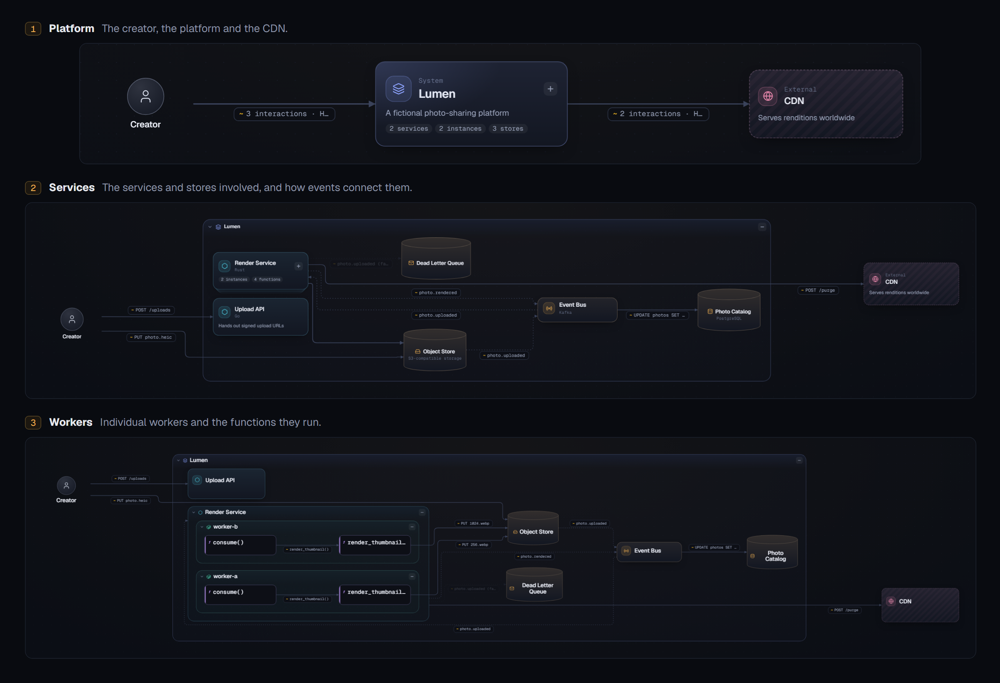
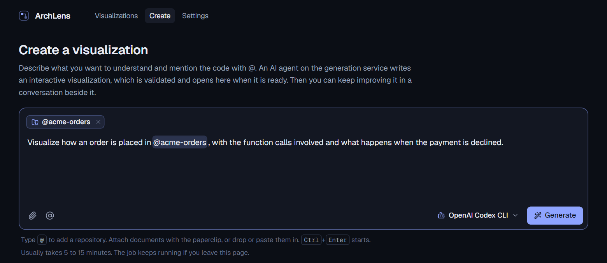

# Using ArchLens

How to explore, create and share visualizations with the ArchLens desktop app. To install it, see the [README](../README.md#install).

## Exploring a visualization

Each visualization has levels of detail. Scroll over the diagram, or press a number key, to move between them. Every level adds the next layer down, and the same scenario plays at every level. To try it, open **Photo Upload Pipeline** on the home page and press `Space`.



| To                              | Do this                                                                                |
| ------------------------------- | -------------------------------------------------------------------------------------- |
| See more or less detail         | Scroll over the diagram, use **Detail** in the toolbar, or press `1` to `5`            |
| Magnify without changing detail | Hold `Alt` while scrolling, or lock the level with `L`                                 |
| Open or close one thing         | Its `+` or `−` button                                                                  |
| Focus on one thing              | Double-click it. Breadcrumbs lead back out                                             |
| Change perspective              | **Architecture**, **Sequence** or **Execution**. Your selection carries over           |
| Follow the flow                 | `Space` plays or pauses, `←` and `→` step, or drag the timeline                        |
| See another outcome             | Pick a scenario in the sidebar, or follow a branch from a decision in the inspector    |
| Inspect anything                | Click it. The inspector shows payloads, signatures, sources and evidence               |
| Read the code behind a claim    | Click a source's file location. It opens in your editor, at that line                  |
| Find something                  | Press `/` to search entities and steps                                                 |
| Change the look                 | **Mode**: Architecture, Execution or Diagnostic. **Motion**: Auto, Full, Subtle or Off |
| Switch between light and dark   | The sun or moon button, at the top of every page                                       |

Source files open in Visual Studio Code, Cursor, Windsurf, Trae, Antigravity, VS Code Insiders, VSCodium, or the default app for the file type. Choose under **Opens in**, below a source list, or in **Settings**.

## Creating a visualization

You need the [Codex CLI](https://github.com/openai/codex), [Claude Code](https://code.claude.com/docs/en/setup) or [Antigravity CLI](https://antigravity.google/docs/cli/), installed and signed in. ArchLens uses that sign-in, and needs no API key of its own. **Settings → Providers** shows what it found.

### In the app

1. On the home page, choose **Create visualization**.
2. Describe what you want to understand. Mention the code with `@`: the first time, type `@`, paste the folder's full path and choose **Add this folder**. Attach design documents with the paperclip, or drop them on the box.
3. Choose the agent and press **Generate**, or `Ctrl`+`Enter`.



A job usually takes 5 to 15 minutes, and keeps running if you leave the page. The result is checked, then opens by itself. To change it, choose **Chat with AI** in the viewer's toolbar and ask. Each change appears at once and can be undone.

**Agents never get to change your code.** Each job runs in its own workspace, inside the agent's sandbox: Codex's operating-system sandbox, which ArchLens tests on your computer first, Claude Code's restricted mode with file tools only, or Antigravity CLI's permission rules with its commands in its own sandbox. Repositories are compared before and after every job, and an existing visualization is never replaced without a review or a backup. Two limits: Codex's sandbox restricts writing and network access, but not reading, and Antigravity's web search cannot be turned off.

### From the coding agent you already use

Open **Settings → Coding agents** and choose **Connect** next to Codex, Claude Code or Antigravity CLI. ArchLens adds itself to the agent's settings with the agent's own command, as `archlens-desktop`, and changes nothing else there. Start a new agent session, then ask for a visualization while working in any repository. Your agent connects to ArchLens while it runs, so the visualization is made in ArchLens, keeps going if you close the agent session, and shows on the **Create** page. ArchLens has to be running when the agent session starts: closing its window keeps it running in the notification area.

To pause agents' use of ArchLens, right-click its icon in the notification area and choose **Stop MCP**, or use the switch in **Settings → Coding agents**. Their ArchLens tools refuse to work until you choose **Start MCP**. Nothing in the agents' settings changes.

In Claude Code, add `mcp__archlens-desktop` to the allowed tools in `/permissions` to use ArchLens without being asked each time. In Antigravity CLI, add `mcp(archlens-desktop/*)` in `/permissions`. Each agent shows whether it is connected. **Test connection** starts ArchLens's server the way the agent would, and **Disconnect** removes it. If you move or reinstall ArchLens, the agent shows **Needs update**: choose **Update**.

### By hand

A visualization is a folder of YAML files. The [examples](../examples) show the format, and the [JSON Schemas](../schema) let editors check each file as you type. Open a folder with **Open a project folder** on the home page.

## Sharing a visualization

### A package

1. In the viewer, open the **Share** menu at the right of the toolbar and choose **Export package (.zip)**.
2. Send the file. The recipient drops it on the home page of ArchLens or [archlens.net](https://archlens.net), or chooses **Import a package**. It opens at once, with nothing to install.

### A link to hosted files

Put the visualization's files somewhere the web can read them, such as a public repository, then send a link that names them:

```
https://archlens.net/view?src=<address>
```

The address can be a `.zip` package, a single `.yaml` document, or a folder holding a `manifest.yaml`. GitHub file and folder pages work as they are, for public repositories. Private repositories do not work, since reading them needs a sign-in: send a package instead. Since the files stay where they are hosted, an update there reaches everyone who opens the link afterwards.

**Before you share, check the files for private details.** Anyone who gets a package or a link can read everything in it. Imports never run anything, and packages with unsafe paths, risky images or credentials are refused.

## Where your files are

| What                    | Where                                                                  |
| ----------------------- | ---------------------------------------------------------------------- |
| Visualizations          | `~/.archlens/visualizations`, or **Help → Open Visualizations Folder** |
| Settings, jobs, history | `~/.archlens`                                                          |
| Logs                    | Windows: `%APPDATA%\ArchLens\logs`. Linux: `~/.config/ArchLens/logs`   |

`~` is your home folder, such as `C:\Users\<you>` on Windows. The menu bar, with **Help**, appears when you press `Alt`. Uninstalling ArchLens keeps these folders.

## When something does not work

- **An agent is not found.** Check that its command works in a new terminal, then restart ArchLens. **Settings → Providers** shows where ArchLens looked, and lets you choose the program yourself.
- **A link from your agent does not open.** ArchLens has to be running. Closing the window keeps it running, unless **Settings → Desktop app** says otherwise.
- **Your agent has no ArchLens tools.** ArchLens has to be running when the agent session starts. Start it, then reconnect in the agent's `/mcp`, or start a new session. After updating from 0.2.0, choose **Update** next to the agent in **Settings → Coding agents** once.
- **Your agent says ArchLens MCP is stopped.** Choose **Start MCP** from ArchLens's icon in the notification area, or in **Settings → Coding agents**.
- **Anything else.** **Help → Open Logs Folder** has the details (press `Alt` for the menu). Please [open an issue](https://github.com/mefaba/archlens-release/issues) and attach the log.

## Limitations

- Windows and Linux only for now. On macOS, [archlens.net](https://archlens.net) opens and shares visualizations, but cannot create them.
- Made for a desktop-sized screen with a mouse or trackpad. Nodes cannot be dragged, on purpose: the layout engine places them, so a visualization looks the same for everyone.
- Generation was tested with Codex CLI 0.166, Claude Code 2.1 and Antigravity CLI 1.5. They change often. ArchLens checks for the features it needs, and says when one is missing.
- Jobs started from your coding agent run in ArchLens, and stop if you quit ArchLens before they finish.
- Not built yet: exporting a single offline HTML file, and importing real traces such as OpenTelemetry.
